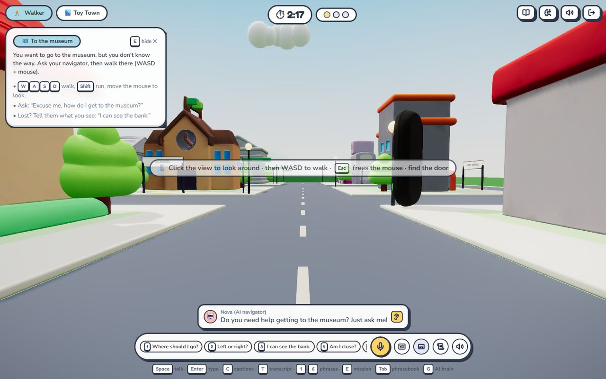
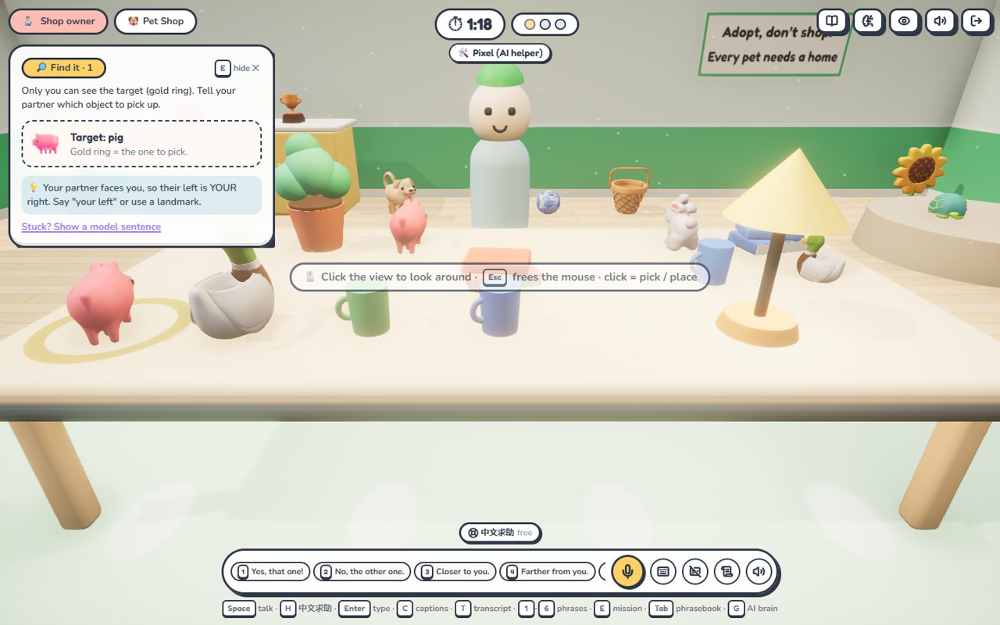
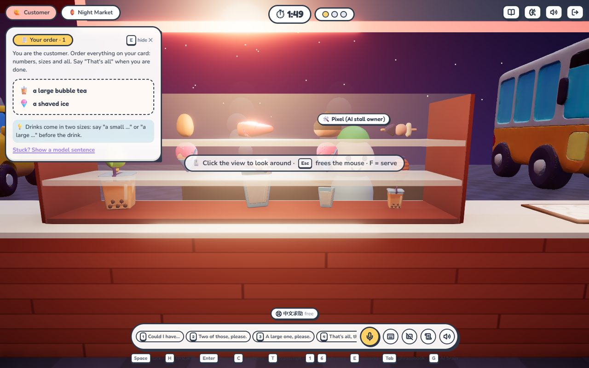
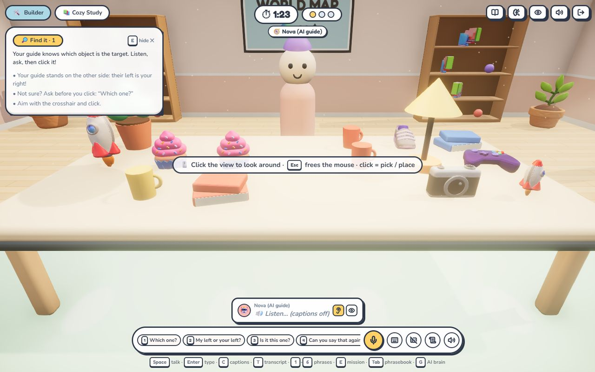
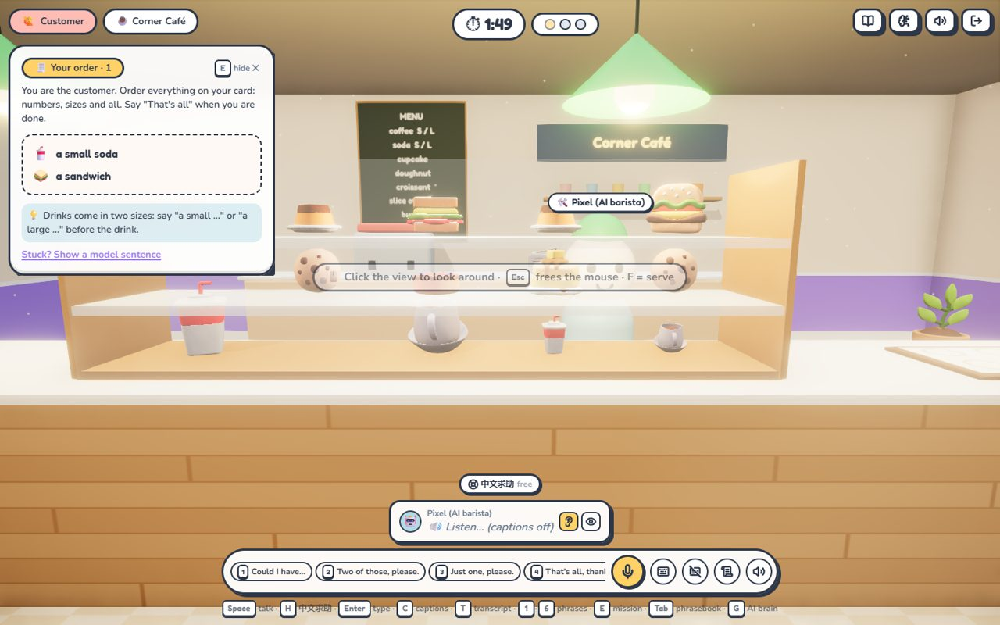
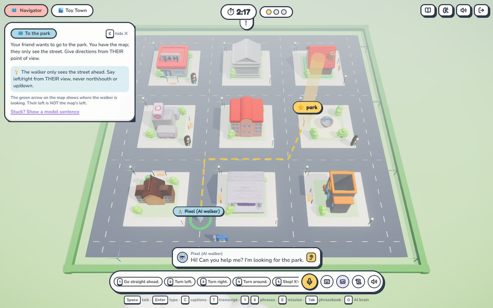
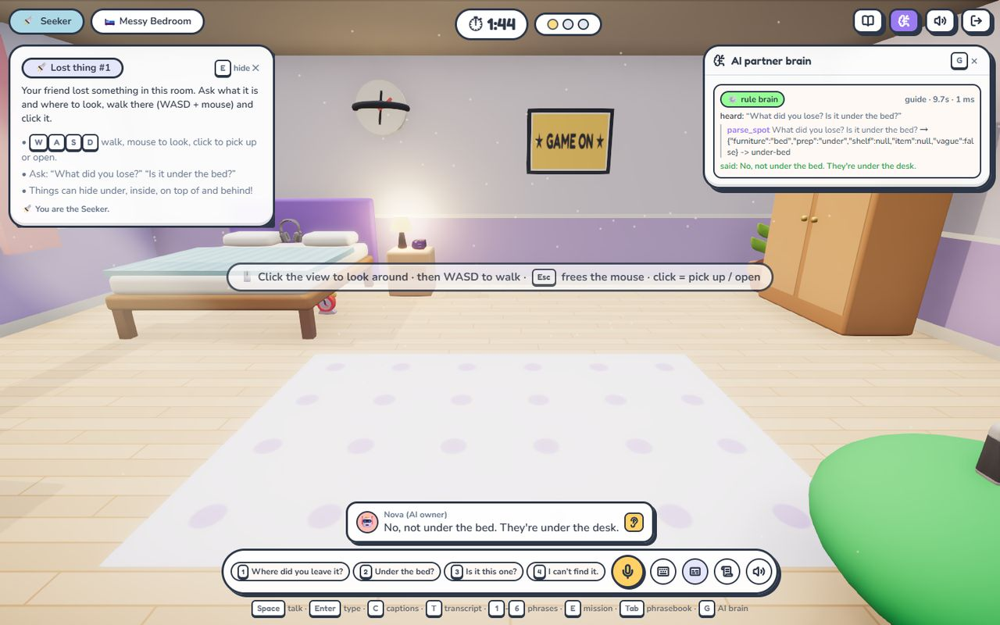
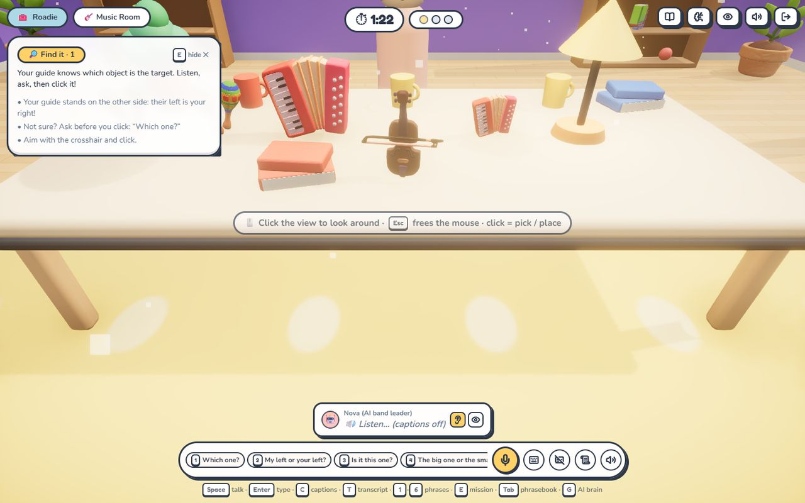
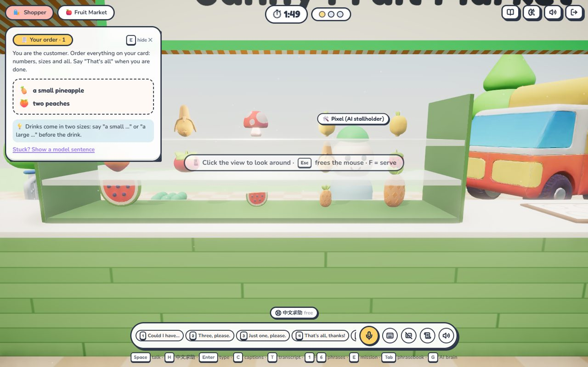

<div align="center">


# ObjectTalk

**Say it clearly, so your teammate can win.**

A two-player 3D game for **speaking** English. One player knows the goal, the other acts in the 3D world:<br/>
find things on a desk, order in a café, **ask for directions while walking through a town**, hunt for lost keys.

[](https://github.com/wangzh12023/objecttalk/actions/workflows/ci.yml)
[](LICENSE)


-4D6BFE)
[](CONTRIBUTING.md)

[Quick start](#-quick-start) · [Levels](#-levels) · [Learning loop](#-the-learning-loop) · [Controls](#-controls) · [AI partner](#-the-ai-partner-agent) · [Scene Agent](#-scene-agent-whole-levels-from-a-theme) · [Product & market](docs/PRODUCT.md) · [Architecture](docs/ARCHITECTURE.md) · [Rodin ×4](docs/RODIN.md) · [中文文档](README.zh-CN.md)



</div>

## 💡 Why

Most speaking practice has no reason to be clear: an AI chat partner understands
anything. In ObjectTalk, unclear English has a visible cost: **your teammate walks
the wrong way, serves the wrong coffee, picks the wrong rocket.**

- 🧭 One player **knows** (the target, the order card, the map, where the keys are) but can't act.
- 🛠️ The other **acts** in the 3D world but never sees the secret.
- 🔄 They see the world differently: across a table *"left"* flips; in a town *"turn left"* depends on where the **walker** is facing.

Every round ends with a replay where a coach checks **every sentence from your
partner's point of view**, shows a clearer way to say it and estimates your
speaking level (CEFR A1 to C1).

## 🚀 Quick start

**Play in the browser now:** https://wangzh12023.github.io/objecttalk/ (GitHub Pages: solo with the AI
partner and the AI-vs-AI demo run entirely in your browser; for two devices, the LLM agent and live
Rodin generation run the full server below. See [docs/DEPLOY.md](docs/DEPLOY.md).)

```bash
git clone https://github.com/wangzh12023/objecttalk.git
cd objecttalk && npm install
npm run dev            # open http://localhost:5173
```

No API keys, no database. Create a room, pick a level, then open a second window
(or scan the QR code with a phone on the same Wi-Fi) to join as the other player.
Playing alone? Choose **"I build, AI guides"**. Want to just watch? Open `/demo`.

<details>
<summary><b>Production / Docker / phones with microphones</b></summary>

```bash
npm run build && npm start           # one process on http://localhost:8787
docker compose up --build            # same, in a container (data persisted in a volume)
npm run dev:https                    # self-signed HTTPS so phones on Wi-Fi may use the mic
```

One-click cloud: the repo includes a [`render.yaml`](render.yaml) blueprint (WebSockets supported).
Set `PUBLIC_URL` so QR codes point at your domain.
</details>

## 🗺️ Levels

| | Level | The one who knows | The one who acts | English you practise |
|---|---|---|---|---|
| 📚 | **Cozy Study** | 🧭 Guide sees the gold target | 🛠️ Builder picks & places on the desk | *next to / between / on YOUR left / closer to you* |
| 🐶 | **Pet Shop** | 🧑‍🔧 Shop owner knows which pet | 🧤 Helper picks up & moves the animals | *the small bunny next to the turtle · the puppy closest to you* |
| ☕ | **Corner Café** | 🙋 Customer holds the order card | 🧑‍🍳 Barista fills the tray from the display case (19-dish menu) | *Could I have two croissants and a large coffee? · Small or large? · Anything else?* |
| 🏮 | **Night Market** | 🧭 Partner holds a private shopping list and street map | 🛍️ Shopper walks between six stores and buys from merchants | *Go to Moon Noodle House and buy two bowls of noodles · turn into the side lane · a large bubble tea* |
| 🏙️ | **Toy Town** | 🗺️ Navigator has the map | 🚶 Walker **walks the streets** (WASD) | *Excuse me, how do I get to…? · Turn left at the bank · It's on your right* |
| 🛏️ | **Messy Bedroom** | 🤔 Owner remembers where things are | 🔦 Seeker **walks the room**, opens boxes | *under the bed · on top of the wardrobe · inside the toy box · warmer / colder* |
| 🎸 | **Music Room** ✨ | 🎼 Band leader | 🧰 Roadie | instrument words + perspective (made by the Scene Agent) |
| 🍎 | **Fruit Market** ✨ | 🛍️ Shopper with a list | 🧑‍🌾 Stallholder | *three peaches, two tomatoes, a large watermelon* (made by the Scene Agent) |

✨ = generated end to end by the [Scene Agent](#-scene-agent-whole-levels-from-a-theme) with Hyper3D Rodin.
Every level has *Easy / Normal / Tricky*: on Tricky the AI partner makes the classic learner mistakes
on purpose ("go north", describing things from its own side, forgetting a size) so you practise catching them.

| Pet Shop (shop owner) | Night Market (customer) |
|---|---|
|  |  |
| **Cozy Study (first person)** | **Corner Café (customer)** |
|  |  |
| **Toy Town: the navigator's map** | **Messy Bedroom + AI partner brain** |
|  |  |
| **Music Room (agent-made)** | **Fruit Market (agent-made)** |
|  |  |

Pick a **quest** for the round (e.g. *Which one?* = only look-alikes, *Party order* = big numbers,
*Long walk*, *Hide and seek*) or play the **📅 Daily Challenge**: the same world and missions in every room
today, so classmates can compare scores.

## 🔁 The learning loop

| | What happens |
|---|---|
| 📝 **Borrowed words** | After the round, every borrowed phrase is listed (*you said it ✓ / not said yet*) and saved to your word book. |
| 👆 **Word cards** | Point at any prop in a scene (73 new Rodin props: plants, vehicles, pets…): its English name pops up; click to hear it and save it. |
| 📒 **Word book** | `/progress`: flip-card review of borrowed phrases, looked-up words and your own photo objects, weakest first. |
| 📷 **Your things in the game** | Object Studio: snap a photo → Qwen3.6 vision names it (English, plural, Chinese, an example sentence) → you practise saying it while Rodin builds it → it hides in the bedroom, sits on the desk or becomes the café's special. |

## 🎮 Controls

**Night Market shopping:** a main street connects Peach Lane and Chestnut Lane, with four timber shops and two temporary table stalls. The partner alone receives the shopping list; every list visits at least two shops and a side lane. Walk to a merchant and click their counter (or press **B**) to buy, return incorrect items from the shopping bag, then bring the bag to the entrance gate and press **F** to deliver. Movement, purchase distance and delivery are checked by the server. Solo AI, two players, AI-vs-AI, mobile joystick and path replays are supported. The shared [Rodin shopkeeper](assets/rodin/nightmarket-owner.json) uses an idle sway without skeletal animation. See the [Chinese walkthrough](README.zh-CN.md#灯火夜市结伴采购).

Click the 3D view once and the mouse is yours, **CS-style**: moving the mouse turns your head,
the crosshair is your pointer, click to interact, <kbd>Esc</kbd> gives the mouse back to the page.

| Key | | Key | |
|---|---|---|---|
| <kbd>W</kbd><kbd>A</kbd><kbd>S</kbd><kbd>D</kbd> / arrows | walk (town, bedroom); <kbd>Shift</kbd> run | <kbd>Space</kbd> (hold) | talk (speech-to-text) |
| click | pick up · place · add to tray · open | <kbd>Enter</kbd> | type a message instead |
| <kbd>F</kbd> | serve the tray (café) | <kbd>1</kbd>–<kbd>6</kbd> | quick phrases for your role |
| <kbd>C</kbd> | captions on / off (**off by default**) | <kbd>T</kbd> | full transcript |
| <kbd>L</kbd> | object labels | click a prop | word card: hear it, save it |

**Voice-first by design.** Reading your partner's text is not speaking practice, so captions are
off: you *hear* the AI (and your friend's transcribed speech), can replay any line with 👂,
peek at one line with 👁 or press <kbd>C</kbd> for captions. Phones get drag-to-look and an
on-screen joystick.

## 🤖 The AI partner (agent)

Play any level with an AI partner (or watch **AI vs AI** at `/demo`). Each partner only knows
what its role knows and only talks through the chat, like a human.

- **LLM tool-use agent** (set `LLM_API_KEY`; defaults to **DeepSeek-V4-Flash**, Claude also supported): every turn runs a bounded agent loop
  (`server/agent/harness.ts`): observe the world → call **grounded tools** (`describe_target`,
  `find_objects`, `route`, `add_to_tray`, `follow`, `go_to`, …) that read and act on the
  authoritative game state → `say`. A **guardrail** re-reads every line from the listener's side
  (and checks directions against the walker's heading) and bounces misleading lines back to the
  model. Hard step limit and deadline, schema-checked tool inputs, full trace in the replay.
- **Rule brain** (always on, offline): dialogue state per level (ticket and "small or large?" in
  the café, step execution with corner counting in the town, "the top shelf or the bottom shelf?"
  in the bedroom), answers the question you actually asked, never repeats itself verbatim, and
  takes over instantly whenever the LLM is off or slow.
- Open the **AI brain** panel from the top bar to see which brain answered, every tool call and result.
- Simulation tests run AI vs AI on every level and difficulty: all missions complete.

## 🏭 Scene Agent: whole levels from a theme

```bash
npm run agent -- level "music class"          # or "fruit market", "science lab", anything
```

`plan` (DeepSeek-V4-Pro or the offline library: engine, roles, phrasebook, 8–12 objects) → `source`
(Fluent Emoji 3D references, rotated upright, 1024²) → `review` (contact sheet; Qwen3.6 vision
rejects bad references) → `generate` (**Hyper3D Rodin Gen-2.5** via `RODIN_API_KEY`, the official
**Hyper3D CLI**, or a hand-off to a coding agent with the **Hyper3D MCP**) → `optimize` (~8 MB →
~300 KB) → `validate` (200 simulated rounds per difficulty must all be solvable) → `publish`
(`content/levels/<id>.json`, live in the lobby without a restart). Music Room and Fruit Market
were made this way: 20 Rodin generations, 157 MB → 5.5 MB, every check PASS.

## 🧊 Rodin at every level

| Level | In ObjectTalk |
|---|---|
| **01 USE** | **130** Rodin Gen-2.5 models: desk objects, pets, café and night-market menus, town buildings, cars & landmarks, bedroom belongings, 42 scenery props with word cards |
| **02 BUILD** | All produced through the **Hyper3D MCP** inside Claude Code; the repo ships `.mcp.json` and enables the official `rodin3d-skill` plugin; workflows packaged as skills (`new-level`, `new-object-pack`) |
| **03 CORE** | Object Studio calls the Rodin API at runtime: your photo becomes a game object |
| **04 AGENT** | The **Scene Agent** generates, validates and publishes whole playable levels |

Provenance (every generation id, prompt, reference): [`assets/rodin/manifest.json`](assets/rodin/manifest.json) · write-up: [docs/RODIN.md](docs/RODIN.md)

## ⚙️ Configuration

Everything is optional. Copy [`.env.example`](.env.example) to `.env`:

| Variable | Default | Purpose |
|---|---|---|
| `PORT` | `8787` | Server port (production) |
| `PUBLIC_URL` | (none) | Base URL used in QR codes when deployed |
| `RODIN_API_KEY` | (none) | Live generation in Object Studio and the Scene Agent |
| `LLM_API_KEY` + `LLM_BASE_URL` | off | Any OpenAI-compatible API (DeepSeek, Qwen, GLM, Kimi or a gateway): AI partner agent, coach + CEFR, Scene Agent planning & vision review |
| `LLM_MODEL` · `LLM_COACH_MODEL` · `LLM_PLANNER_MODEL` · `LLM_VISION_MODEL` | `deepseek-v4-flash` · `deepseek-v4-pro` · `deepseek-v4-pro` · `qwen3.6-35b-a3b` | Model per job; comma-separated lists are fallbacks |
| `LLM_PROVIDER=anthropic` + `ENABLE_LLM=1` + `ANTHROPIC_API_KEY` | off | Use Claude instead (`ANTHROPIC_MODEL`, default `claude-opus-5-5`) |
| `LLM_PARTNER` | on | Set `0` to keep the LLM for coaching only |
| `ICE_SERVERS` | public STUN | WebRTC voice link (add TURN for strict networks) |

Graphics: `?fx=off|low|high` overrides the automatic post-processing level (remembered per browser).

## 🧪 Development

```bash
npm run check          # typecheck + 80 tests (engines, NLU, agent harness, AI-vs-AI sims, real Socket.IO games) + build
npm test               # vitest
npm run agent          # Scene Agent help
```

```
shared/   language engines (no dependencies): room/spatial/reg/nlu/missions (study),
          cafe, city, bedroom, levels, coach, cefr, analysis
server/   Express + Socket.IO: Room + level engines, AI partners (rule brains + LLM agent harness),
          Rodin, Object Studio, agent-made level store
src/      React 19 + React Three Fiber: first-person controls, 4 scenes + env kit, voice-first HUD, replay
agent/    Scene Agent CLI: whole levels (v2) and object packs (v1), Hyper3D REST / CLI / MCP hand-off
content/  published agent-made levels
tests/    vitest: engines, NLU, agent harness, AI-vs-AI simulations, end-to-end games
```

## 🙏 Acknowledgements

Built for **ShanghaiTech Techathon 2026**. 3D models by [Hyper3D Rodin](https://hyper3d.ai);
reference art from [Microsoft Fluent Emoji](https://github.com/microsoft/fluentui-emoji) (MIT);
UI style inspired by a playful claymorphism template; 2D-over-3D interaction inspired by
[medkit](https://github.com/bedriyan/medkit-app). Full list: [docs/THIRD_PARTY.md](docs/THIRD_PARTY.md).

Released under the [MIT License](LICENSE).
