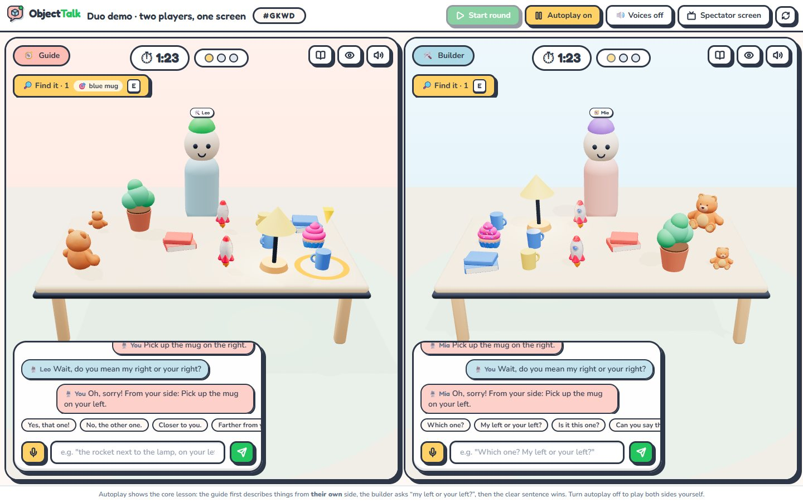
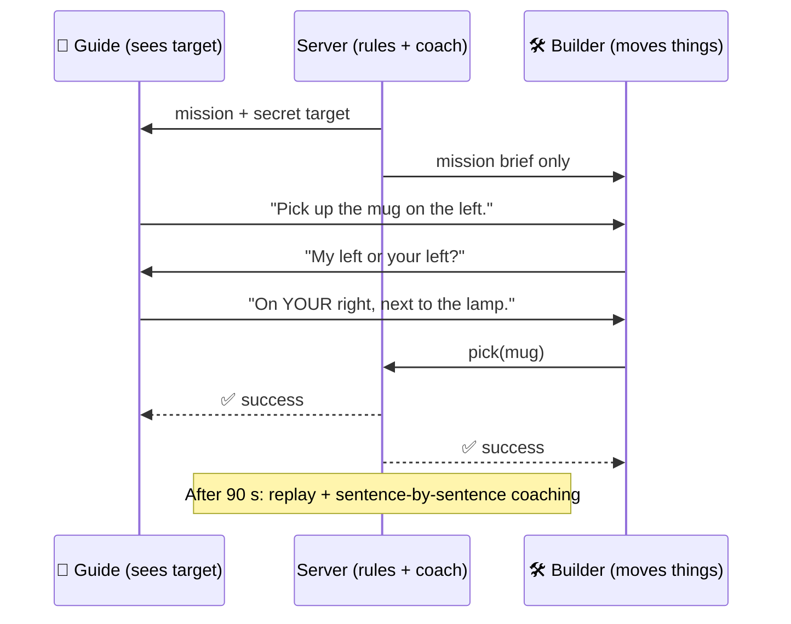
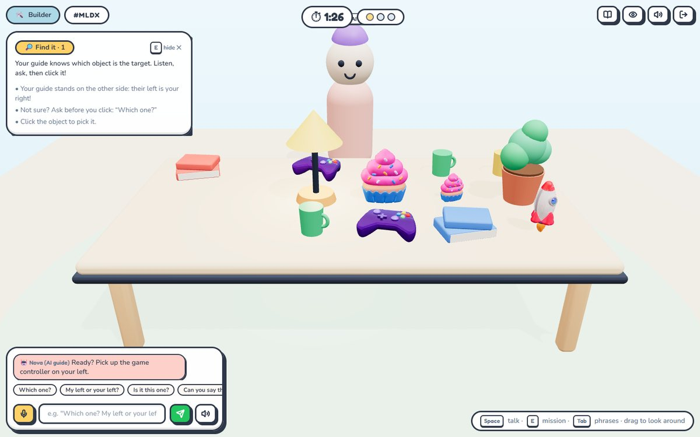
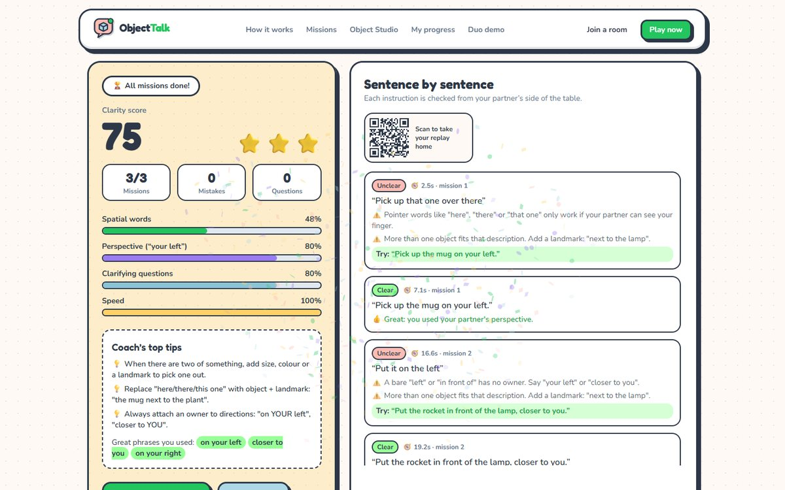
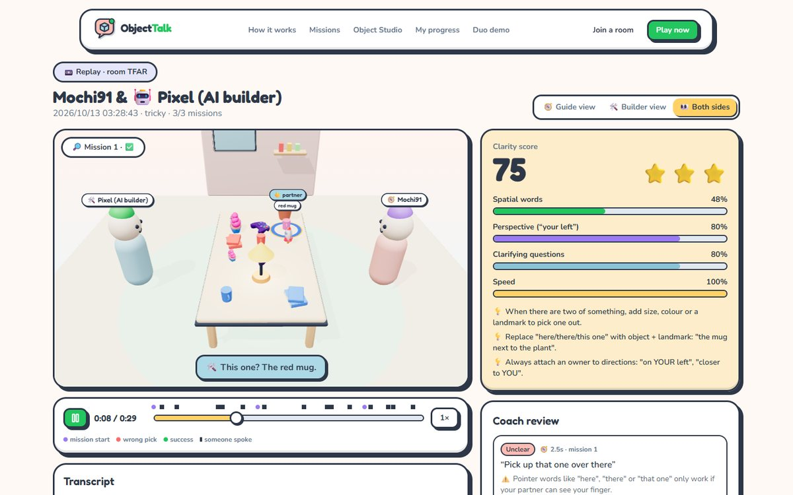
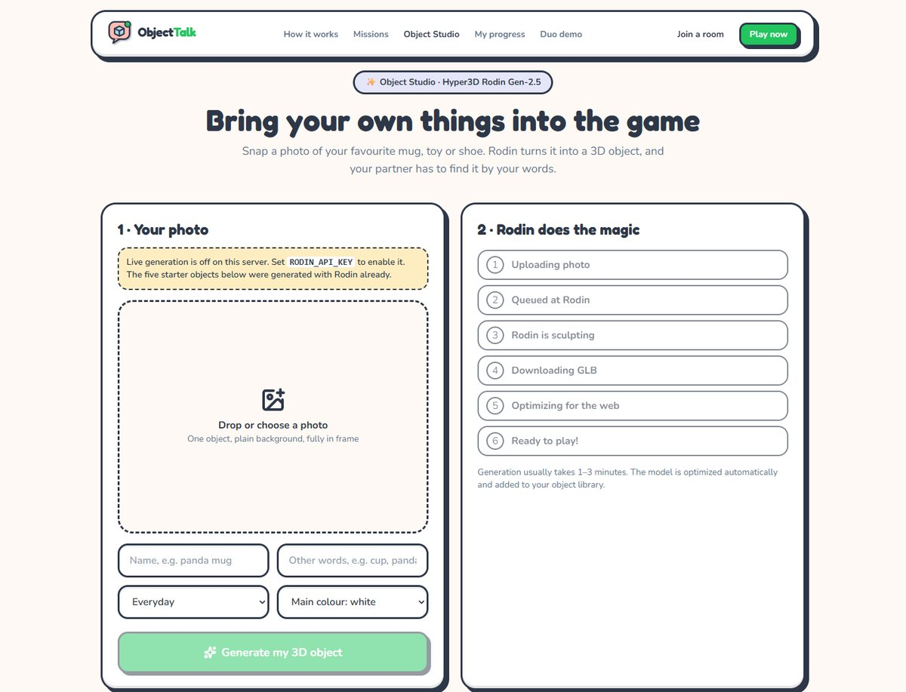

<div align="center">


# ObjectTalk

**Say it clearly, so your teammate can win.**

A two-player 3D English game. One player sees the goal, the other moves the objects,<br/>
and you stand on **opposite sides of the table**: your left is their right.

[](https://github.com/wangzh12023/objecttalk/actions/workflows/ci.yml)
[](LICENSE)


-D97757?logo=anthropic&logoColor=white)
[](CONTRIBUTING.md)

[Quick start](#-quick-start) · [How it works](#-how-it-works) · [Features](#-features) · [Architecture](docs/ARCHITECTURE.md) · [Rodin ×4](docs/RODIN.md) · [中文文档](README.zh-CN.md)



</div>

## 💡 Why

Most speaking practice has no reason to be clear: an AI chat partner understands
anything. In ObjectTalk, unclear English has a visible cost: **your teammate picks
the wrong object**.

- 🧭 **Guide** sees the target but can't touch anything.
- 🛠️ **Builder** can move things but never sees the target.
- 🔄 They face each other, so *"on the left"* means two different places.

Ninety seconds, three missions, then a replay where a coach checks **every sentence
from your partner's side** and shows a clearer way to say it.

## 🚀 Quick start

```bash
git clone https://github.com/wangzh12023/objecttalk.git
cd objecttalk && npm install
npm run dev            # open http://localhost:5173
```

That's it: no API keys, no database. Create a room, then open a second window
(or scan the QR code with a phone on the same Wi-Fi) to join as the other player.
Playing alone? Choose **"I build, AI guides"**.

<details>
<summary><b>Production / Docker / phones with microphones</b></summary>

```bash
npm run build && npm start           # one process on http://localhost:8787
docker compose up --build            # same, in a container (data persisted in a volume)
npm run dev:https                    # self-signed HTTPS so phones on Wi-Fi may use the mic
```

One-click cloud: the repo includes a [`render.yaml`](render.yaml) blueprint (WebSockets supported).
Set `PUBLIC_URL` so QR codes point at your domain.
</details>

## 🎮 Ways to play

| Mode | Where | Best for |
|---|---|---|
| 👫 **With a friend** | `/play` → *Create a room*, partner scans the QR code | the real thing: talk face to face or remotely |
| 🤖 **With an AI partner** | `/play` → *I build, AI guides* / *I guide, AI builds* | solo practice; on *Tricky*, Nova describes things from **her** side to test you |
| 🖥️ **Split-screen demo** | `/demo` (Autoplay on) | presenting both roles on one screen, hands-free |
| 📺 **Spectator screen** | `/watch/CODE` | the booth's big screen: both views side by side + live transcript |
| 📼 **Replay & coach** | `/replay/:id` | scrub through the round from either player's view |
| ✨ **Object Studio** | `/studio` | turn a photo of **your own** object into a 3D game object with Rodin |

## 🧩 How it works



The heart of the project is a **perspective-aware spatial-language engine** (`shared/`):
the same code generates missions that always have one clear answer, powers both AI
partners, and grades every sentence afterwards. Details: [docs/ARCHITECTURE.md](docs/ARCHITECTURE.md).

## ✨ Features

| | |
|---|---|
| 🎯 **Asymmetric 3D room**: two cameras on opposite sides; the target is sent only to the guide (enforced on the wire) | 🧠 **Spatial-language engine**: perspective frames, referring-expression generation, rule NLU, playability simulator |
| 🔎📦 **Two mission types**: *Find* (look-alikes) and *Place* ("behind the red book, but whose behind?") | 🤖 **AI partners**: Nova reacts to what you point at; Pixel asks "Which one?" and "My left or yours?" |
| 🎙️ **Talk naturally**: push-to-talk speech-to-text, AI voices, quick phrases, phrasebook with Chinese glosses, optional WebRTC voice | 📈 **Coach & progress**: clarity score, 4 skills, verdict + fix for every sentence, local progress dashboard |
| 🧊 **Your interests become the level**: 5 Rodin Gen-2.5 objects (−96 % size), plus your own photos via Object Studio | 🏭 **Scene Agent**: plan → reference → review → Rodin → optimize → register → validate, for whole object packs |
| 📼 **3D replay**: timeline with events, three camera views, synced subtitles, QR code to take it home | 📱 **Booth-ready**: QR join over LAN, phone layout, spectator screen, fully offline fallback |

## 📸 Screenshots

| Builder view (phone or laptop) | Coach report |
|---|---|
|  |  |
| **3D replay** | **Object Studio (Rodin)** |
|  |  |

## 🧊 Rodin at every level

| Level | In ObjectTalk |
|---|---|
| **01 USE** | 5 hero objects generated with Rodin Gen-2.5 image-to-3D, optimized 39.8 MB → 1.44 MB |
| **02 BUILD** | Produced through the Hyper3D MCP inside Claude Code; reusable as the `new-object-pack` skill |
| **03 CORE** | Object Studio calls the Rodin API at runtime: your photo becomes a game object |
| **04 AGENT** | `npm run agent`: a Scene Agent that plans, generates and **validates** object packs |

Provenance (generation ids, prompts, references, sizes): [`assets/rodin/manifest.json`](assets/rodin/manifest.json) · write-up: [docs/RODIN.md](docs/RODIN.md)

## ⚙️ Configuration

Everything is optional. Copy [`.env.example`](.env.example) to `.env`:

| Variable | Default | Purpose |
|---|---|---|
| `PORT` | `8787` | Server port (production) |
| `PUBLIC_URL` | (none) | Base URL used in QR codes when deployed |
| `RODIN_API_KEY` | (none) | Enables live generation in Object Studio and the Scene Agent |
| `ENABLE_LLM` + `ANTHROPIC_API_KEY` | off | Claude fallback for the AI builder, coaching rewrites, agent planning |
| `ICE_SERVERS` | public STUN | WebRTC voice link (add TURN for strict networks) |

## 🧪 Development

```bash
npm run check          # typecheck + tests (unit + real Socket.IO games) + build
npm test               # vitest
npm run agent -- validate   # playability simulation of the catalog
```

```
shared/   spatial-language engine (no dependencies): room, spatial, reg, nlu, missions, analysis
server/   Express + Socket.IO: rooms, AI partners, Rodin + Claude services, Object Studio
src/      React 19 + React Three Fiber client: pages, 3D scene, HUD, replay
agent/    Scene Agent CLI (object packs)
tests/    vitest: engine, NLU, missions/coach, end-to-end games
```

## 🗺️ Roadmap

- [ ] Mirror Match mission (rebuild the whole table from words)
- [ ] More rooms (kitchen, classroom, space station) from the Scene Agent
- [ ] Teacher dashboard: class codes, common mistakes across students
- [ ] On-device speech recognition for networks without Google speech

## 🙏 Acknowledgements

Built in 48 hours for **ShanghaiTech Techathon 2026**. 3D objects by
[Hyper3D Rodin](https://hyper3d.ai); reference art from
[Microsoft Fluent Emoji](https://github.com/microsoft/fluentui-emoji) (MIT);
UI style inspired by a playful claymorphism template; 2D-over-3D interaction
inspired by [medkit](https://github.com/bedriyan/medkit-app). Full list:
[docs/THIRD_PARTY.md](docs/THIRD_PARTY.md).

Released under the [MIT License](LICENSE).
