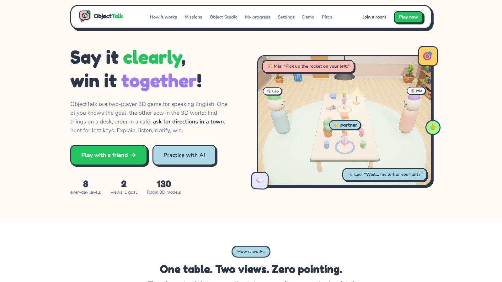
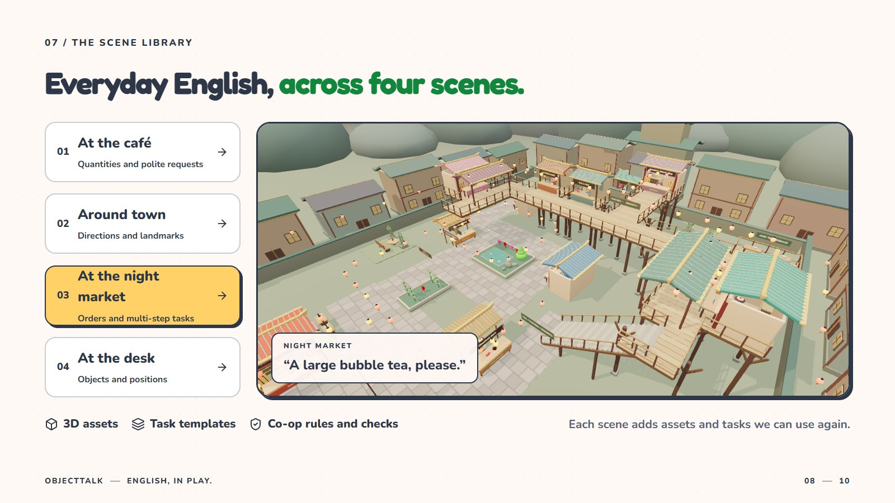
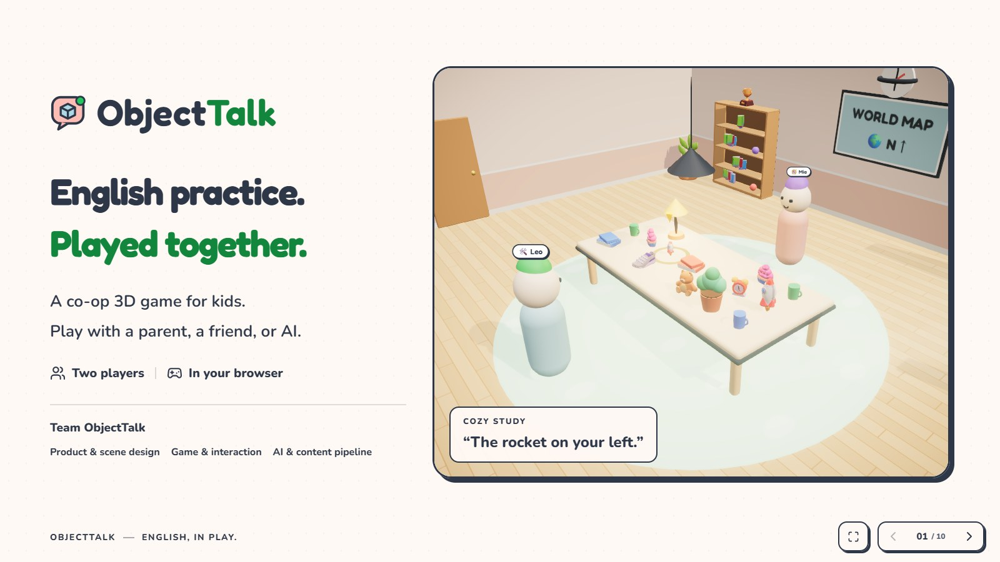

<div align="center">


# ObjectTalk

### Say it clearly. Solve it together.

A two-player 3D English game. One player sees the goal. The other makes the move.

[](https://github.com/wangzh12023/ObjectTalk-Game/actions/workflows/ci.yml)
[](https://github.com/wangzh12023/ObjectTalk-Game/actions/workflows/pages.yml)


[**Play in your browser**](https://wangzh12023.github.io/ObjectTalk-Game/) · [**Watch the film**](https://wangzh12023.github.io/ObjectTalk-Game/demo) · [**Pitch presentation**](https://wangzh12023.github.io/ObjectTalk-Game/pitch) · [简体中文](README.zh-CN.md)



</div>

## English with a reason to be clear

“Move the rocket left.” **Whose left?**

In ObjectTalk, each teammate knows something the other does not. Describe the target, ask a question, and act together. Words change where the objects go, what reaches the tray, and which street your partner takes.

Play with a friend, a parent, or an AI teammate. At the end of a round, review the conversation, replay the actions, and practise clearer expressions.

## Pick a world

| World | Work together to… | English in action |
|---|---|---|
| Cozy Study | Find and place the right objects | Position, perspective, clarification |
| Corner Café | Complete the customer's order | Quantities, sizes, polite requests |
| Toy Town | Guide a walker through the streets | Directions and landmarks |
| Messy Bedroom | Find something hidden in the room | Containers, furniture, location |
| Night Market | Visit shops, climb galleries, and finish a shopping list | Orders and multi-step directions |
| Music Room, Fruit Market, Pet Shop | Explore more everyday tasks | Objects, descriptions, and requests |



## A complete practice loop

- **Different views, one shared task.** The acting player cannot see the answer.
- **Voice first.** Speak with your teammate; typing and optional captions are available.
- **An AI partner that acts.** Rule-based partners work without provider keys; a configured LLM can use bounded game tools.
- **Private help when you need it.** Ask for an English phrase in Chinese, then say it yourself.
- **Feedback you can inspect.** Replays, suggested expressions, vocabulary review, and an estimated speaking level.
- **Your objects, in the game.** Object Studio can identify a photo and generate a playable 3D object with Hyper3D Rodin.
- **More worlds from a scene brief.** Scene Agent plans, generates, validates, and publishes compatible levels.

## Watch or present

The **53-second film** introduces the product and shows the original live 3D scenes. The **ten-slide pitch** includes the finished film, scene switching, keyboard navigation, and fullscreen playback.



[Open the pitch](https://wangzh12023.github.io/ObjectTalk-Game/pitch) · [Download the 1080p60 film](https://wangzh12023.github.io/ObjectTalk-Game/demo/ObjectTalk-launch-film-53s-1080p60.mp4)

## Run locally

Requires **Node.js 22 or later**.

```bash
git clone https://github.com/wangzh12023/ObjectTalk-Game.git
cd ObjectTalk-Game
npm ci
npm run dev
```

Open **http://localhost:5173**. Create a room, choose a world, and invite a second player or choose an AI teammate.

No API key is needed for local rule-based play. To use your own AI or live 3D generation, copy `.env.example` to `.env` and configure `LLM_API_KEY`, `LLM_BASE_URL`, and/or `RODIN_API_KEY`. Keep these server-only values out of the browser and Git.

| Command | Purpose |
|---|---|
| `npm run dev` | Frontend and realtime server |
| `npm run check` | Type checking, tests, and production build |
| `npm run build && npm start` | Run the complete production application |
| `npm run build:pages` | Build the GitHub Pages frontend |
| `npm run agent -- level "music class"` | Generate and validate a new level |

## Hosting

The frontend can run on **Vercel or GitHub Pages**. Models, fonts, textures, and films are served with the frontend; realtime rooms, AI calls, generated objects, and replay persistence live on the Node server.

Set the public HTTPS backend in `deployment.config.json` or override it with `VITE_BACKEND_URL`. Provider keys belong only on the backend. The included `vercel.json` sets the SPA routes and static-asset cache headers; the Pages workflow deploys each push to `main`.

To make a standalone offline Pages build, set `VITE_BACKEND_URL` to an empty string while running `npm run build:pages`. In that mode, rule-based solo play and replays run inside the browser; cross-device rooms and online AI require the backend.

The hosted backend currently runs on the team's computer through a temporary HTTPS tunnel. It requires that computer and tunnel to remain online; a tunnel restart may require updating the public endpoint.

## Built with

React 19 · TypeScript · Three.js · React Three Fiber · Socket.IO · Express · Tailwind CSS

**131 optimized 3D models**, generated with [Hyper3D Rodin](https://hyper3d.ai), complement the project's procedural rooms, streets, furniture, and avatars. Models load by scene and are cached independently of the AI backend.

## License and credits

ObjectTalk source code is available under the **[MIT License](LICENSE)**. Generated assets and third-party material retain their own terms; see **[NOTICE.md](NOTICE.md)**. Reference artwork includes Microsoft Fluent Emoji. The finished film uses original synthesized music.

Made for **ShanghaiTech Techathon 2026**.
