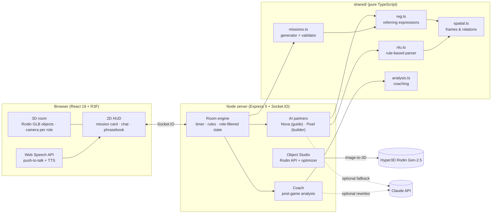

# Architecture

ObjectTalk is a single TypeScript codebase with three layers that share one
"brain" (`shared/`). Everything runs in one Node process plus static files, so
`npm start`, `docker run` and `npm run dev` behave the same.

## 1. The spatial-language engine (`shared/`)

The table is a 6 × 3 grid. The guide stands at −z, the builder at +z, so every
direction word has to be evaluated **in someone's frame**:

| File | Responsibility |
|---|---|
| `room.ts` | Grid ↔ world coordinates, player viewpoints, `toFrame(cell, role)`: x grows to that player's right, y grows toward them. |
| `spatial.ts` | Relation predicates (`nextTo`, `near`, `between`, `leftOf`, `rightOf`, `inFrontOf`, `behind`) and superlatives (`leftmost`, `nearest`, …). `resolveRef` / `resolvePlace` turn a description into the set of objects/cells it can mean. An unmarked "left" is resolved under **both** readings, which is how ambiguity is detected. |
| `reg.ts` | Referring Expression Generation: enumerates intrinsic (size/colour), relational (landmarks) and superlative descriptions, keeps only those that pick out exactly the target **from the listener's view**, ranks by simplicity, and realizes English ("behind the red book, farther from you"). |
| `nlu.ts` | Deterministic parser for spatial English: multi-word relation phrases, owner words (*your/my*), frame clarifiers (*closer to you*, *from your side*), between-X-and-Y, intents (pick / place / question / confirm / deny), and flags for vague pointer words. |
| `missions.ts` | Builds a scene from the players' interests (identical twins + size pairs + coloured mugs), generates **Find** and **Place** missions, and only accepts a mission if a clear listener-side description exists. `simulatePlayability` plays hundreds of rounds to prove it. |
| `analysis.ts` | The coach: replays each instruction against the scene **at that moment**, from the partner's side; classifies it (clear / ok / unclear / misleading), names the issue (perspective flip, unmarked direction, ambiguity, vague pointer) and suggests a clearer sentence generated by `reg.ts`. |

Because the AI partners, the mission generator and the coach all use the same
engine, what the AI says, what the game accepts and what the coach praises are
always consistent.

## 2. Realtime server (`server/`)

- **Authoritative rooms** (`game/room.ts`): lobby → countdown → playing → results.
  All builder actions (`pick`, `place`, `drop`) are validated on the server.
- **Information asymmetry on the wire**: `Room.missionFor()` sends the target
  only to the guide and spectators. Opening dev tools as the builder reveals nothing.
- **Replay log**: every mission start, hover (throttled), pick, place, wrong move
  and chat line is timestamped. Replays are stored as JSON (`data/replays`).
- **AI partners** (`game/bots.ts`) are virtual players in the room, using the same
  action API as humans. Pixel's rule parser can fall back to Claude
  (`services/llm.ts`, structured outputs, opt-in).
- **Object Studio** (`services/studio.ts`): upload → Rodin Gen-2.5 → poll → download
  → `services/optimize.ts` (glTF-Transform: WebP + meshopt, ~96 % smaller) → catalog.

### Socket protocol (`shared/protocol.ts`)

| Client → server | Server → client |
|---|---|
| `room:create`, `room:join`, `room:leave`, `room:settings`, `room:role` | `room:state` (role-filtered full state) |
| `game:start`, `game:again` | `fx` (pick / place / wrong / success / mission) |
| `act:hover`, `act:pick`, `act:place`, `act:drop` | `hover` (the builder's pointer) |
| `chat:send` (text / voice transcript / quick phrase) | `chat`, `chat:history` |
| `rtc:signal` (WebRTC voice link) | `rtc:signal` |

State is small (a few KB), so the server simply re-sends it on every change.
That makes reconnection trivial: the client rejoins with its stored player id
and receives the full state.

## 3. Client (`src/`)

- **One `GameClient` per player** (`lib/game-client.ts`): its own socket + zustand
  store. The split-screen demo page runs two of them side by side.
- **3D** (`components/three`): `RoomScene` (camera rig per role with limited
  orbit, local image-based lighting with no CDN, gold target ring, ghost destination,
  live "partner is pointing here" marker, slot discs when holding an object),
  `models.tsx` (GLB clones with per-instance materials, procedural mug, landmarks, avatars).
- **2D overlays on the 3D view**, in the style of medkit: mission card (**E**),
  phrasebook with Chinese glosses (**Tab**), push-to-talk (**Space**),
  object labels (**L**), put back (**Esc**).
- **Speech**: Web Speech API push-to-talk (en-US) and speechSynthesis for AI lines.
  Typing is always available as a fallback (the Google speech backend may be
  unreachable on some networks).

## 4. Key design decisions

| Decision | Why |
|---|---|
| Rule-based NLU + REG instead of an LLM in the loop | Instant, free, deterministic, works offline at a venue, and testable. An LLM is used only where rules give up. |
| Server-authoritative state, full-state broadcast | Simple and cheat-proof; tiny payloads; reconnect for free. |
| Image-to-3D with reviewed references | Rodin's image mode is much more reliable than text-to-3D; references from Fluent Emoji 3D give a consistent toy-like style that matches the clay UI. |
| meshopt + WebP instead of Draco/KTX2 | Decoders ship with three-stdlib / browsers, so no CDN fetches (gstatic is unreliable in mainland China). |
| Self-hosted fonts (@fontsource) | Google Fonts may be slow or blocked at the venue. |
