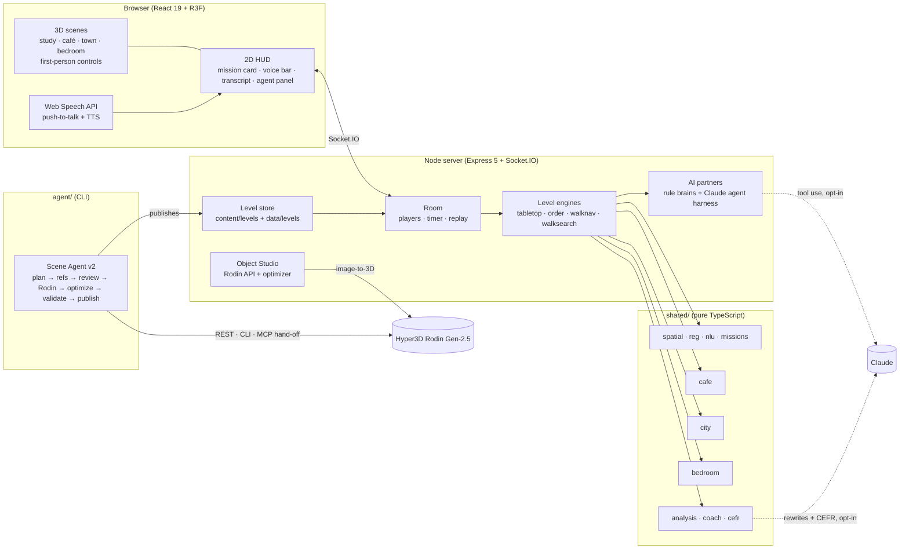

# Architecture

ObjectTalk is a single TypeScript codebase with three layers that share one
"brain" (`shared/`). Everything runs in one Node process plus static files, so
`npm start`, `docker run` and `npm run dev` behave the same.

## 1. Language engines (`shared/`)

Each level is an everyday situation with its own engine. All engines are pure
functions with no dependencies, so the server, the client, the AI partners, the
coach and the Scene Agent's validator share them.

| File | Level | What it does |
|---|---|---|
| `room.ts`, `spatial.ts`, `reg.ts`, `nlu.ts`, `missions.ts` | Cozy Study (+ agent tabletop levels) | A 7 × 3 desk grid seen from opposite sides. `toFrame(cell, role)` gives each player their own left/right; `reg.ts` generates descriptions that are unique **from the listener's side**; `nlu.ts` parses spatial English (*your/my*, *closer to you*, *between X and Y*) and flags unmarked directions; `missions.ts` only accepts missions with a clear answer and `simulatePlayability` proves it. |
| `cafe.ts` | Corner Café (+ agent order levels) | Display case + small/large drinks, order generation by difficulty, `trayStatus` (missing / extra), and `parseOrder` (numbers, sizes, plurals with no number, negation per clause, "make that three", "that's all"). |
| `city.ts` | Toy Town | 4 × 4 street grid, 8 Rodin buildings + a park on randomized lots and door sides, traffic lights, bus stop. `planRoute` produces directions **relative to the walker's heading and position** (between corners or at one), picks landmarks that identify exactly one corner, and `parseDirections` turns sentences into steps (*turn left at the bank*, *take the second right*, *go straight for two blocks*) and flags map words (*north*, *up*) a walker cannot use. `collide` keeps walkers on streets. |
| `bedroom.ts` | Messy Bedroom | Furniture with collision boxes and 12 hiding spots (under, on, on top of, inside, between, behind) each with a standing point; `parseSpot` / `matchSpots` understand *"No, not on the bed. It's under the desk."* (negated clauses are ignored). |
| `analysis.ts`, `coach.ts` | all | The coach replays every sentence against the world **at that moment**, from the partner's side: perspective flips and unmarked directions (study), missing sizes / numbers / plurals / politeness (café), map words and turns that are wrong from the walker's heading (town), wrong furniture or preposition (bedroom). Each sentence gets a verdict, the issue and a model sentence. |
| `cefr.ts` | all | A transparent CEFR estimate (A1–C1) from the human's sentences: length, lexical variety, place/direction phrases, linking words, polite forms, questions and self-repairs, with reasons and one next step. The Claude coach can refine it. |
| `levels.ts` | all | Level registry (roles, controls, phrasebooks, quick phrases) plus a runtime registry for agent-made levels. |

## 2. Realtime server (`server/`)

- **Room** (`game/room.ts`): players, seats, modes (`duo`, `ai`, `sim` = AI vs AI with human
  spectators choosing a view), countdown, timer, mission sequencing, chat, replay log and
  traces. The level-specific rules live in **engines** (`game/engines/*.ts`) behind one
  interface (`LevelEngine`): `begin`, `startMission`, `missionFor(view)`, `world(view)`,
  actions (`pick`, `place`, `tray`, `serve`, `move`, `open`) and `report`.
- **Information asymmetry on the wire**: `missionFor` / `world` are computed per viewer.
  The builder never receives the target, the order card or the hiding spot; in the bedroom
  even the contents of the closed toy box are withheld until the seeker opens it.
- **Walking**: clients predict their own movement and send `act:move` (rate-limited); the
  server clamps speed, applies the same collision as the client, detects arrival and
  broadcasts `pose` to everyone else. Poses are sampled into the replay as a trail.
- **AI partners** (`game/bots/*.ts`): one rule brain per role per level, sharing
  `bots/common.ts` (timers that die with the round, a no-verbatim-repeat speech queue, dialogue
  acts). Partners hear lines after a speech-length delay, so two AIs never talk over each other.
- **Agent harness** (`agent/harness.ts`, `agent/partner.ts`): when Claude is enabled, a partner
  hands its turn to a bounded tool-use loop. Tools are grounded in the engine state (look-ups
  and actions), inputs are schema-checked, unknown tools are refused, and `say` goes through a
  level-specific **guardrail** (`vetSay`) that re-reads the line from the listener's side and
  returns `NOT SAID: <reason>` so the model can repair it. A deadline and step limit bound every
  turn; the rule brain answers whenever Claude is off, slow or silent. Each turn is emitted as an
  `ai:trace` (brain, tool calls, results, output, latency) and stored with the replay.
- **Level store** (`services/levels.ts`): loads `content/levels/*.json` (shipped) and
  `data/levels/*.json` (made on this server), re-reading changed files on each request.
- **Object Studio** (`services/studio.ts`) and **optimizer** (`services/optimize.ts`):
  glTF-Transform dedup/prune/weld, centre and normalize, WebP textures, meshopt (~96 % smaller).

### Socket protocol (`shared/protocol.ts`)

| Client → server | Server → client |
|---|---|
| `room:create`, `room:join` (role or spectator `viewAs`), `room:leave`, `room:settings` (level, mode, difficulty…), `room:role` | `room:state` (per-viewer state: scene, world, mission) |
| `game:start`, `game:again` | `fx` (pick, place, tray, serve, reveal, arrive, wrong, success…) |
| `act:hover`, `act:pick`, `act:place`, `act:drop` | `hover` (what the builder points at) |
| `act:tray`, `act:serve` (café), `act:open` (bedroom) | `pose` (live walker pose) |
| `act:move` (walking levels) | `ai:trace` (AI partner reasoning) |
| `chat:send` (voice transcript / text / quick phrase) | `chat`, `chat:history` |
| `rtc:signal` (WebRTC voice link) | `rtc:signal` |

## 3. Client (`src/`)

- **One `GameClient` per player** (`lib/game-client.ts`): socket + zustand store, throttled
  pose streaming. The demo page runs two of them side by side.
- **First-person controls** (`components/three/controls.tsx`): click to capture the mouse
  (Pointer Lock), mouse-look with no dragging, a crosshair that raycasts from the screen centre
  (custom R3F event `compute`), WASD/arrows + Shift with collision for walking levels, drag-to-look
  and an on-screen joystick on touch screens. Spectators and replays orbit instead.
- **Scenes**: `RoomScene` (study), `CafeScene`, `CityScene`, `BedroomScene`, built from a small
  environment kit (`env.tsx`: N8AO ambient occlusion, bloom on real light sources only, vignette,
  ACES tone mapping, soft dust, light shafts, painted canvas signs, sky dome, clouds) and a
  furniture kit (`furniture.tsx`: rooms with inward-facing walls so a dollhouse camera sees in,
  open shelves, windows, lamps, posters). No downloaded HDRs or textures. `?fx=off|low|high`.
- **Voice-first HUD**: `VoiceBar` (hold Space / mic, Enter to type, 1–6 quick phrases, C
  captions, T transcript, TTS for partner lines with "hear again"), `MissionCard` (E) per level,
  `AgentPanel` (G), phrasebook (Tab).
- **Replay** rebuilds any moment from the initial world + event log + pose trail, for every level.

## 4. Scene Agent (`agent/`)

`npm run agent -- level "<theme>"` (see [RODIN.md](RODIN.md)): `level.ts` (pipeline, resumable
state in `agent/runs/<id>/run.json`), `level-library.ts` (offline plans, every reference
verified to exist), `hyper3d.ts` (REST, official Hyper3D CLI, or MCP hand-off), `llm.ts`
(structured planning + vision review), `setup.ts` (`.mcp.json` + Rodin skill marketplace).
Validation reuses the game's own engines, so a published level is playable by construction.

## 5. Key design decisions

| Decision | Why |
|---|---|
| Deterministic engines + an optional LLM agent on top | Rules are instant, free, testable and work offline at a venue; the Claude agent makes the partner feel natural, and the engines both ground its tools and guard what it says. |
| One engine per everyday situation behind a common interface | New situations (and agent-made levels) plug in without touching rooms, replays or the HUD. |
| Client-predicted walking, server-validated | Smooth first-person movement over Wi-Fi without trusting the client. |
| Captions off by default | The game is for speaking and listening; text is one key away when needed. |
| Image-to-3D with reviewed references | Rodin's image mode is much more reliable than text-to-3D; Fluent Emoji 3D references give one consistent toy style that matches the clay UI. |
| meshopt + WebP instead of Draco/KTX2, self-hosted fonts | No CDN fetches at runtime (gstatic and Google Fonts are unreliable in mainland China). |
